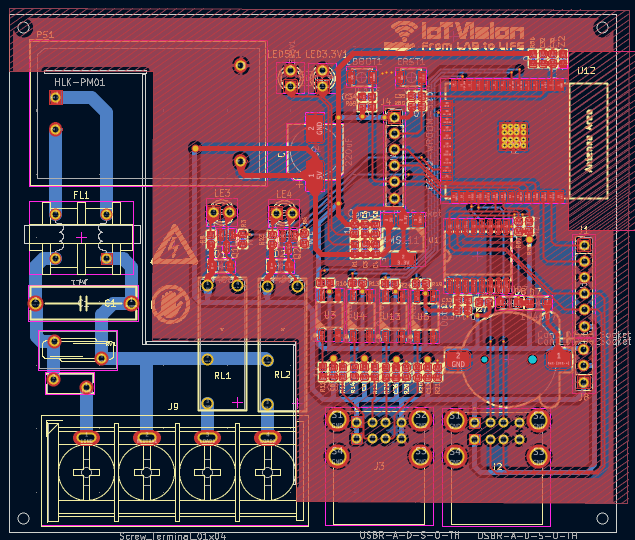
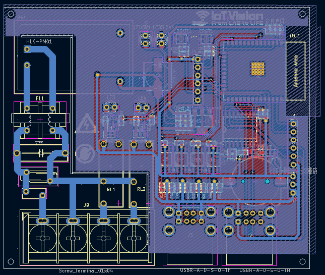
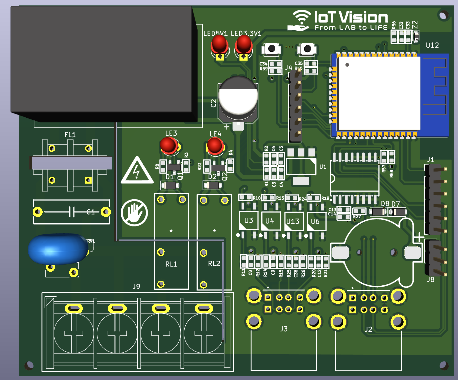
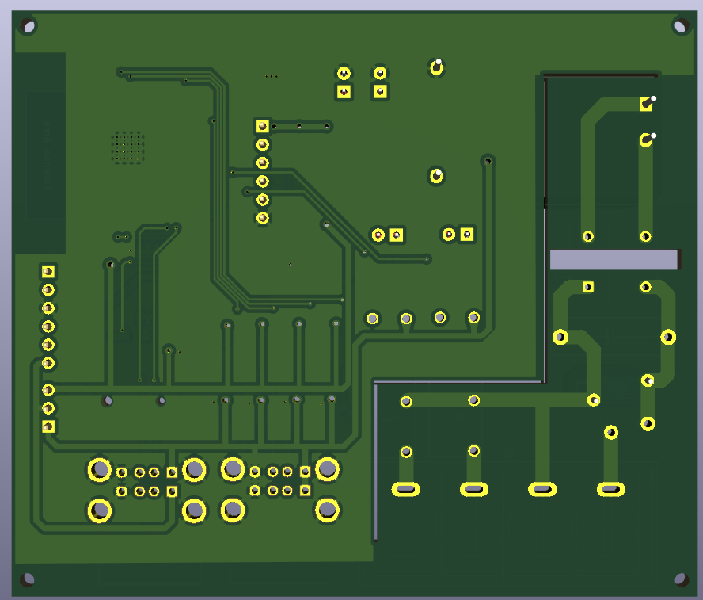

# ESP32 IoT Smart Controller

[](https://www.kicad.org/)
[](https://www.espressif.com/)
[](https://www.dwin-global.com/)
[]()
[]()
[]()

---

## Table of Contents

1. [Overview](#overview)
2. [Design Requirements](#design-requirements)
3. [Hardware Design](#hardware-design)
   - [Schematic](#schematic)
   - [PCB Layout and Routing](#pcb-layout-and-routing)
4. [Repository Structure](#repository-structure)
5. [Author](#author)

---

## Overview

This project is a compact **Wi-Fi IoT Monitoring and Control Board** designed in KiCad 9.0 (developed as **Mini-Project 11**). Built around the **ESP32-WROOM-32E** module, the board integrates an onboard AC-DC power supply, opto-isolated digital inputs, relay outputs, a high-precision Real-Time Clock (RTC), and dedicated dual USB-A style interfaces for external sensors and a touchscreen HMI display.

External switch inputs are isolated from the logic side using **EL357N-G optocouplers**, protecting the ESP32 from electrical noise and voltage spikes in field environments. The board is powered directly from the 220 V AC mains and steps down the voltage to 5 V DC and 3.3 V DC.

Main functions:

- **Convert power** directly from 220 V AC mains to 5 V DC (`HLK-PM01`) and 3.3 V DC (`AMS1117-3.3`) with built-in fuse, varistor, and EMI filtering.
- **Switch** two AC loads independently using **Omron G5NB-1A-E** relays driven by N-channel MOSFETs.
- **Read** four opto-isolated digital switch inputs (`EL357N-G`) routed through an external USB-A receptacle.
- **Measure** ambient temperature and humidity via an **SHT3x** sensor over I2C, connected through a rugged USB-A style port with selectable 5 V / 3.3 V power (`J8`).
- **Interface** with a **DWIN UART HMI** touchscreen display via a dedicated port (`ERX2`, `ETX2`, 5 V, GND).
- **Maintain** accurate timekeeping with an onboard **DS3231** RTC and `CR1220` coin-cell battery backup.

---

## Design Requirements

### Summary

| Item | Target |
| --- | --- |
| MCU | ESP32-WROOM-32E (Wi-Fi / BLE SoC) |
| Power input | 220 V AC mains (via 4-pin screw terminal) |
| Power rails | 5 V DC (`HLK-PM01` 3 W) and 3.3 V DC (`AMS1117` LDO) |
| Inputs | 4 opto-isolated digital inputs (`EL357N-G`) |
| Outputs | 2 SPST-NO relay outputs (`Omron G5NB-1A-E`, 5 A @ 250 V AC) |
| RTC | `DS3231M` (I2C) with `CR1220` backup battery and trickle-charge circuit |
| External interfaces | Dual USB Type-A receptacles (SHT3x I2C sensor, DWIN UART HMI, 4x switches) |
| Programming & Expansion | 6-pin UART/Boot header (`J4`) and 6-pin I2C/GPIO header (`J1`) |
| Revision | V1.0 |

### Functional requirements

**Power Supply**
- Resettable PTC fuse (`Bourns MF-RG300`), metal oxide varistor (`RV1`), X-capacitor (`1 uF`), and common-mode choke (`UU9.8-HF`) on the 220 V AC input.
- Isolated `HLK-PM01` AC-DC module generating the primary 5 V DC rail.
- `AMS1117-3.3` LDO regulator stepping down 5 V DC to 3.3 V DC for the ESP32 and logic circuits, complete with 5 V and 3.3 V power indicator LEDs and a `5.1 V` Zener clamp (`Z2`) on the VDD line.

**Inputs**
- Four opto-isolated digital channels (`U3`, `U4`, `U6`, `U13` using `EL357N-G`) with input RC filtering and pull-up resistors to 3.3 V.
- External switch connections (`SW1`–`SW4`) wired through stacked USB Type-A receptacle `J3`.

**Outputs**
- Two relay channels (`RL1`, `RL2` using `G5NB-1A-E`) switching the AC Neutral line to `LOAD1` and `LOAD2` on the main screw terminal (`J9`).
- Driven by `IRLML0030` N-channel MOSFETs (`Q1`, `Q2`) with `1N4007` flyback diodes (`D1`, `D2`) and status indicator LEDs (`LE3`, `LE4`).

**Microcontroller, RTC, and Peripherals**
- **ESP32-WROOM-32E** with tactile Reset (`ERST1`) and Boot (`EBOOT1`) buttons.
- **DS3231M** RTC communicating over I2C (`SCL1`, `SDA1`) with `CR1220` battery backup (`BT1`) and a diode-resistor charging path (`D7`, `D8`, `R27`).
- Stacked USB Type-A receptacle `J2`:
  - Port A: **DWIN HMI** interface (`5V`, `ERX2`, `ETX2`, `GND`).
  - Port B: **SHT3x Sensor** interface (`VB`, `SDA1`, `SCL1`, `GND`) with a 3-pin jumper (`J8`) to select `5V` or `3.3V` for `VB`.

---

## Hardware Design

### Schematic

Key components from the schematic (`Bai11.kicad_sch`):

| Block | Main components |
| --- | --- |
| MCU | `ESP32-WROOM-32E`, `B3U-1000P` tactile switches (`EBOOT1`, `ERST1`), `5.1V` Zener (`Z2`) |
| Power | `HLK-PM01` (AC-DC 5 V), `AMS1117-3.3` LDO, `Bourns MF-RG300` fuse, 12 mm disc varistor, `UU9.8-HF` EMI filter |
| Isolated Inputs | 4x `EL357N-G` optocouplers (`U3`, `U4`, `U6`, `U13`), dual USB-A connector (`J3`) |
| Relay Outputs | 2x `Omron G5NB-1A-E` 5 V relays (`RL1`, `RL2`), 2x `IRLML0030` MOSFETs (`Q1`, `Q2`), `1N4007` flyback diodes, 4-pin 9.5 mm pitch screw terminal (`J9`) |
| Timekeeping (RTC) | `DS3231M` (`SOIC-16W`), `CR1220` SMD battery holder (`BT1`), `1N4007` diodes (`D7`, `D8`) |
| Sensor & HMI Ports | Dual USB-A connector (`J2`), 1x03 voltage selector header (`J8`), 1x06 programming header (`J4`), 1x06 GPIO/I2C header (`J1`) |

### PCB Layout and Routing

The PCB is a 2-layer FR-4 board (`1.6 mm` thickness, `1 oz` copper) with clear physical separation between the 220 V AC high-voltage section (left side) and the low-voltage logic/wireless section (right side). High-voltage warning silkscreens and an antenna keepout zone for the ESP32 module are strictly maintained.

**Layout**

| Top layer | Bottom layer |
| :---: | :---: |
|  |  |

**3D view**

| Top side | Bottom side |
| :---: | :---: |
|  |  |

---

## Repository Structure

```
ESP32_IoT_Smart_Controller/
├── Images/                     # PCB layout and 3D render images
├── Bai11.kicad_pro             # KiCad 9.0 project file
├── Bai11.kicad_prl             # Project local settings
├── Bai11.kicad_sch             # Complete circuit schematic
├── Bai11.kicad_pcb             # 2-layer PCB layout file
├── Bai11.pdf                   # Exported schematic PDF
├── Bai11.step                  # 3D STEP model of the assembled board
├── fp-info-cache
└── README.md
```
---

## Author

- **Huynh Vo Phuc Loc**
- GitHub: [Dong-quan](https://github.com/Dong-quan)
